# Keycloak live run

This record describes the existing local Keycloak 26.8.1 synthetic realm through strict public
HTTPS, used by the durable Synapse sandbox. The current API is
`sha256:15be92cbec55907328c1a8db99d4a9f153b54992adc73b3931c712aa4f56ee9a` and web is
`sha256:921e6509aa5abbdf1e40899f37835b4cf90959d49998c1204ad7d98261c91813`, bound to the reviewed
shared source in Auth0 PR #1612 commit `a2de17b9`. The original #1609 executable baseline was
equivalent to the earlier Auth0 baseline, but this run consumes later shared repairs. It does not
claim that the unmodified #1609 source head alone contains those repairs.

## Accepted release scope

The final delivery incorporates the reviewed Auth0 foundation through commit
`35e1a435d038bc1e3634e69a781c46e088dbe9f0`; all production Go, API, migration and frontend bytes
match that reviewed parent. The Keycloak-specific delta contains its maintained native conformance,
release gate and evidence. It does not preserve a parallel backport of shared identity features.

The release decision on 26 October 2026 accepts the existing real browser journeys together with
maintained native conformance. A second sandbox realm grant or another additive-link enrollment is
not required to repeat the shared approved-link flow. The separate custom-path sandbox realm and
connection remain disabled; no activation or new access is inferred from this scope decision.

Public discovery and signed Test of the custom-base-path realm passed against the strict gateway.
The native gate exercises real Keycloak discovery, signed tokens and approved admission under both
ordinary and `/auth` paths, unknown/wrong-realm denial, PKCE, real client-secret replacement with
old-secret denial, ordinary login preserving the existing link, and session-epoch rejection after
disable. Retained browser evidence separately proves public transport, default-subject enrollment,
pairwise remap denial/restoration, signing-key overlap, mailbox recovery and Required canary fallback.
No receipt is relabelled as a new run or a different provider.

Shared UI validation and token-outage repairs are included in the reviewed Auth0 parent. Their
functional candidate provenance covers the exact executable files now inherited here. Earlier
paragraphs that describe uncommitted backports or open shared-repair cells are historical checkpoints,
superseded by this source consolidation and the final verification record. The existing hostname,
credentials and sandbox configuration remain retained; this does not promise permanent Quick Tunnel
DNS or permit silently changing an issuer after restart. No billing, new cloud service, extra grant
or Auth0 signing-key rotation was added.

The final combined-source native run passed ordinary and `/auth` layouts in 45.87 and
43.52 seconds respectively. Its source hashes, pinned images, actual result and zero-resource
cleanup are recorded in [the final conformance receipt](keycloak-release-conformance.json).
The native test files and all production bytes remained unchanged during this run; only evidence
Markdown/JSON was reconciled afterward. Hosted repository Actions are still disabled, so this
receipt claims local native execution only.

## Signing-key overlap and login

On 25 October 2026, the existing linked synthetic person first switched from default readonly to
secondary readonly through a real Keycloak password prompt. The validated upstream authentication
time was 13:45:18 UTC and the resulting session was created at 13:45:22 UTC.

At 13:47:34 UTC, the local Keycloak admin API created a higher-priority generated RS256 signing
component in the same realm. The original signing component was retained. Public HTTPS JWKS
contained both original and new RSA key IDs, and the issuer was unchanged. Keycloak metadata
selected the new RS256 signer; the client/realm ID-token algorithm was RS256.

The existing Synapse session still reached Dashboard after reload. Local logout then revoked it,
and ordinary Keycloak authorization returned through the real callback to the same existing
person and secondary readonly membership. The new callback completed after rotation. Neither API
image nor container start time changed, so this did not rely on restarting the API's verifier.
All observations retained five persons, seven memberships, eight authenticators, connection
revisions, roles and policies, including secondary Required SSO.

The selected signer is inferred from provider active-key metadata, configured algorithm, public
JWKS and the successful post-rotation callback. Raw ID-token headers/claims were not retained.
The public-key overlap is observed directly. The twenty-minute rollback guard was disarmed only
after the browser and persistence assertions passed; the old and new keys remain in the durable
local realm. Explicit rollback remains available and removes only the new component.

No user, membership, client secret, cloud resource, public endpoint or billing was added by this
drill. This does not claim client-secret rotation, a different realm, or changed subject.

Source: `keycloak-jwks-rotation.json`, containing nonsecret public key IDs, exact runtime identity
and hashes of the original observations and screenshots. Private key material was never exported.

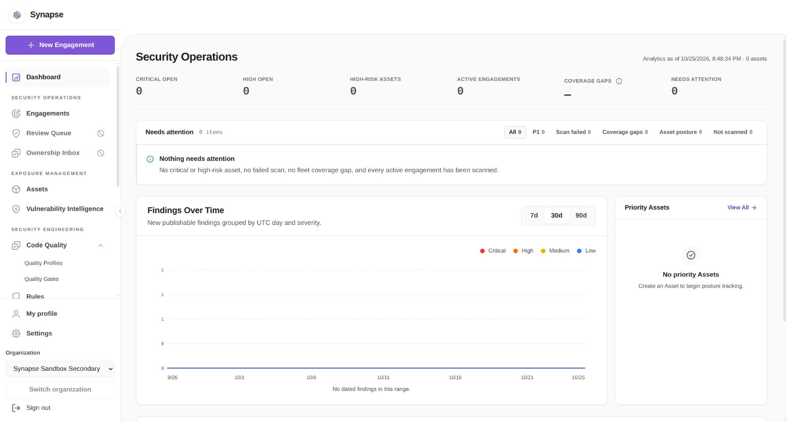

## Pairwise subject remap and restoration

At 14:05 UTC, the existing linked synthetic person signed in through Auth0 to the default
readonly membership. Only the Keycloak synthetic client's default scope assignment was then
changed: a temporary copy retained the original `auth_time` fields and replaced the public-sub
mapper with Keycloak's `oidc-sha256-pairwise-sub-mapper`. The shared `basic` scope, issuer, client
secret, other scopes, users, Synapse connections and policies were untouched. Keycloak added an
explicit `userinfo.token.claim=true` default to the copied authentication-time mapper. The client
had one loopback redirect host and the original scope had no role-scope mappings to omit.

The admin-generated example ID-token payload showed a different subject hash while issuer,
audience, client, email and JSON boolean `email_verified=true` stayed equal. This unsigned preview
was a configuration precondition, not the federation proof; raw callback JWTs were not retained.
A real browser destination switch then forced the same Keycloak user to enter its password.
The callback displayed “The identity you selected is not approved for this action. Your existing
sign-in is still active.” The default Dashboard remained usable after reload. Persistence showed
no new secondary session and preserved the source Auth0 authentication time of 14:05:07 UTC.

Restoration reattached the original `basic` scope, detached and deleted only the temporary scope,
and verified the exact original default and optional scope sets plus the original example subject.
A new ordinary Keycloak callback then reached secondary readonly as the same existing person at
14:08:58 UTC. No API restart occurred. All stages kept five persons, seven memberships and eight
authenticators, unchanged membership roles, connection revisions and policies. The twenty-minute
automatic restore guard was stopped; no remapping remains active. A preflight mapper-default
assertion had previously stopped before attaching the temporary scope and restored it successfully.

This proves denial of a changed pairwise subject on an existing link and recovery after restoring
the original subject. It does not prove approved pairwise enrollment or additive linking.
No membership, credential, cloud resource or billing was added. Nonsecret observations and capture
hashes are in [the remap evidence](keycloak-pairwise-remap.json).
The mapper and example endpoints follow the official [Keycloak mapper reference](https://www.keycloak.org/admin-api/protocol-mappers)
and [Admin REST API](https://www.keycloak.org/docs-api/26.8.1/rest-api/index.html).

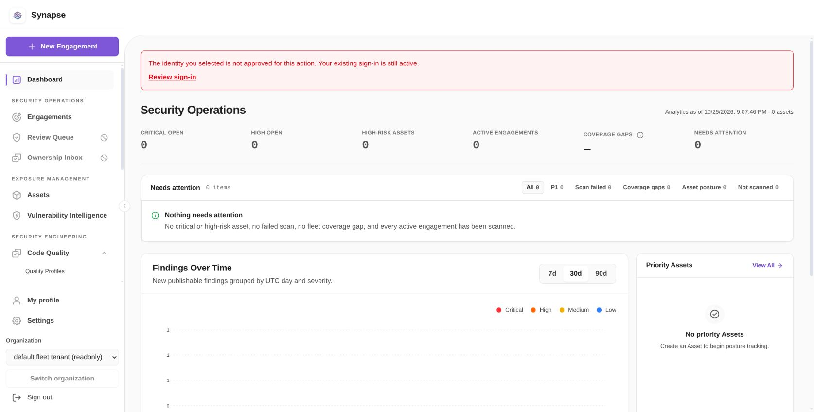

## Missing authentication time and retry

At 14:14 UTC, the same synthetic person held an Auth0 default readonly session. A second
client-local scope replacement retained only the original Keycloak subject mapper and omitted
`auth_time`. The shared `basic` scope and all other client assignments stayed unchanged. The admin
example kept the same subject, issuer, audience, client, email and boolean verification. The
preview has no user-session authentication time even in the baseline, so it was not used as proof
that the callback claim was missing.

Ordinary Keycloak authorization reused recent provider SSO. The real destination callback at
14:15 UTC was denied with the existing-sign-in-active message. No new secondary session appeared;
default readonly Dashboard still loaded after browser reload. Restoring the exact original default
and optional scopes, deleting the temporary scope and retrying produced a new callback session at
14:16:47 UTC for the same secondary readonly person. Validated provider authentication time was
14:07:24 UTC. Five persons, seven memberships, eight authenticators, roles, policies and connection
revisions remained unchanged, without API restart. The restore timer is inactive.

Missing authentication time is inferred from the isolated real-provider mapper omission and
callback denial; raw callback JWTs were not retained. This omission run does not claim stale proof
or a new password prompt; the separate stale-time control below covers that condition. The previous fresh-password run remains the separate positive control.
See [the nonsecret evidence and artifact hashes](keycloak-missing-auth-time.json).

## Stale authentication time and retry

At 14:23 UTC, the synthetic person obtained a new Auth0 password session in default readonly.
A guarded client-local Keycloak scope replaced only the ordinary authentication-time mapper with
an official hardcoded-claim mapper. It set `auth_time` to the JSON `long` value for 14:03:46 UTC.
The original subject mapper and all other scopes remained. The unsigned admin example showed the
integer old value with the same subject, issuer, audience, client, email and boolean verification.
The shared `basic` scope, client secret, issuer, Synapse clock and session records were untouched.

A real Keycloak password reauthentication then completed, but its destination callback was denied
with the existing-sign-in-active message. At the post-denial observation, the mapped timestamp was
1,267 seconds old, exceeding the 900-second freshness limit. The Auth0 source authentication was
still recent. No new secondary session appeared and the source Dashboard worked after reload.
After restoring the exact original default/optional scopes and deleting the temporary scope, a new
ordinary callback reached the same secondary readonly person. The persisted authentication time
was the real recent Keycloak password time, rather than the controlled old value. Roles, policies,
connection revisions and five persons/seven memberships/eight authenticators remained unchanged;
the API did not restart and the restore timer is inactive.

This is a synthetic negative provider fixture: no natural fifteen-minute wait or old real-user
authentication time is claimed. The callback claim value is inferred from the isolated real
Keycloak mapper and actual denial; raw callback JWTs were not retained. The fresh password
procedure alone did not admit a token configured with stale proof. See
[the nonsecret fixture, session observations and capture hashes](keycloak-stale-auth-time.json).

## Remaining certification

The retained accountless Quick Tunnel provides actual public HTTPS but its hostname depends on
that process. No permanent issuer availability after tunnel replacement is claimed. The stable
hostname decision remains separate; no silent issuer rebinding is allowed.

Other required issue #1517 cells remain open, including cross/custom-base-path realm boundaries,
approved pairwise enrollment/linking, client-secret rotation and the complete shared-flow
matrix. Historical enrollment, local logout and existing-session provider-outage recovery are
mapped below; the full canary recovery cells remain open. Signed-out Connect is covered in the
subsequent run below. The owner's
theme waiver applies; no theme matrix is claimed. This incremental run is not a declaration that
#1517 is ready to close.

## Enrollment and local session lifecycle

The earlier 25 October 2026 run at 09:00–09:30 UTC used the shared Auth0 source candidate based
on `27bd3c96`, with its recorded source delta. Its API image was
`sha256:4707488f9ef6576264ad2e1d0b0c9f446deea8033bbafe6135b3f38c00ff68ef` and web image was
`sha256:095c61d7e5b97747abea4a2092966d179b47adb72faeb3a68e42975ae88b571e`.
These are historical images, separate from the current runtime identified at the top of this file.
The snapshot files have no embedded image ID; the retained source provenance, promotion and
pending-activation records bind that earlier runtime. This does not certify the unmodified
Keycloak PR executable head.

Native Settings / Authentication Test and Activate enabled revision 1/version 2/epoch 1. The real
Test at 09:00:25 UTC expired exactly one hour later. Existing Auth0 connections and secondary
Required policy remained unchanged. Before enrollment, ordinary provider authentication for the
unapproved synthetic user reached a useful denial. Persistence stayed at three persons, four
memberships and four authenticators, with no Keycloak membership or session.

After the explicitly approved readonly invitation, that first Keycloak profile user appeared as
one person, one secondary readonly membership and one approved authenticator. Local logout left
no active session for that person. Ordinary login without an invitation, followed by Profile
reauthentication, returned to the same person and readonly role. The second synthetic user then
accepted its own approved readonly invitation and completed ordinary login/reauthentication.
The run ended at five persons, six memberships and six authenticators. Earlier memberships,
Auth0 connections and the Required policy were preserved.

The contemporaneous functional summary records invitation acceptance; the persistence snapshots
do not contain invitation-consumption state. Consumed codes were not replayed. Reauthentication
reused recent provider SSO; this run does not claim a forced password prompt or termination of the
provider session. Existing signed-in same-person enrollment, signed verified-email variants and
complete disable/recovery/rollback remain separate required cells.

[`keycloak-enrollment-run.json`](keycloak-enrollment-run.json) contains the reduced observations,
source/image binding, raw-observation hashes and limits. No invitation code, credential, token or
session identifier is published.

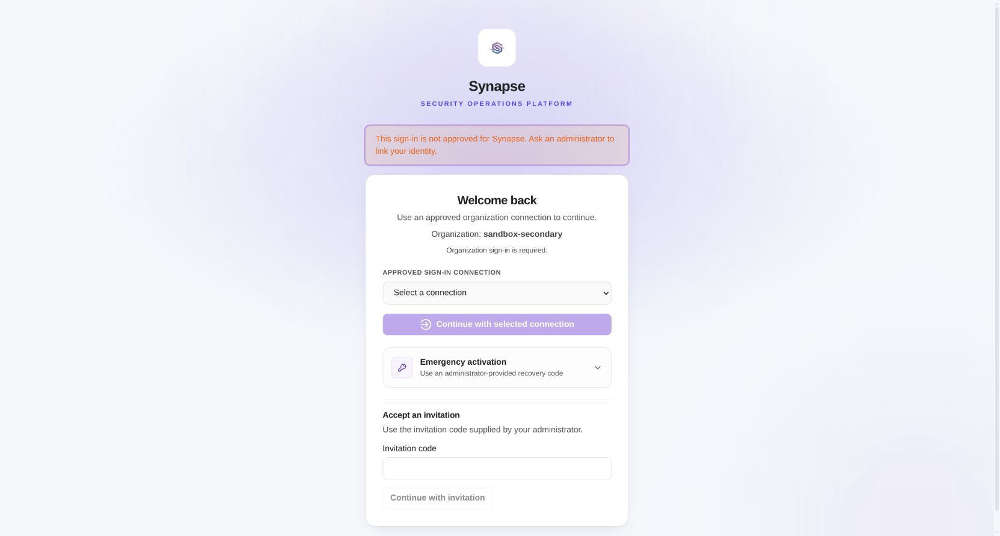

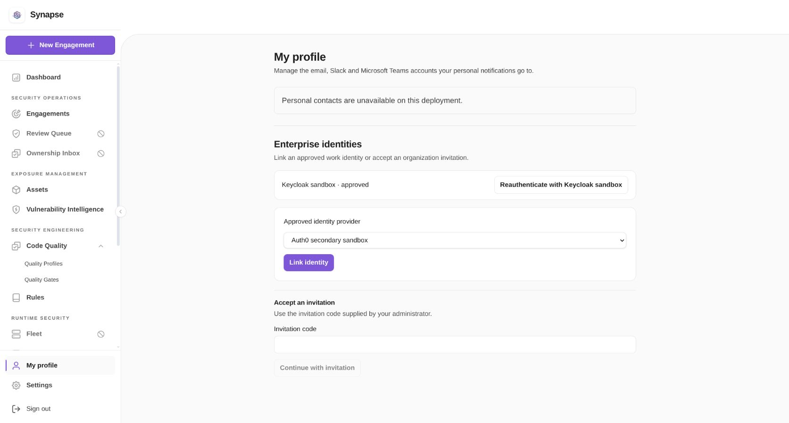

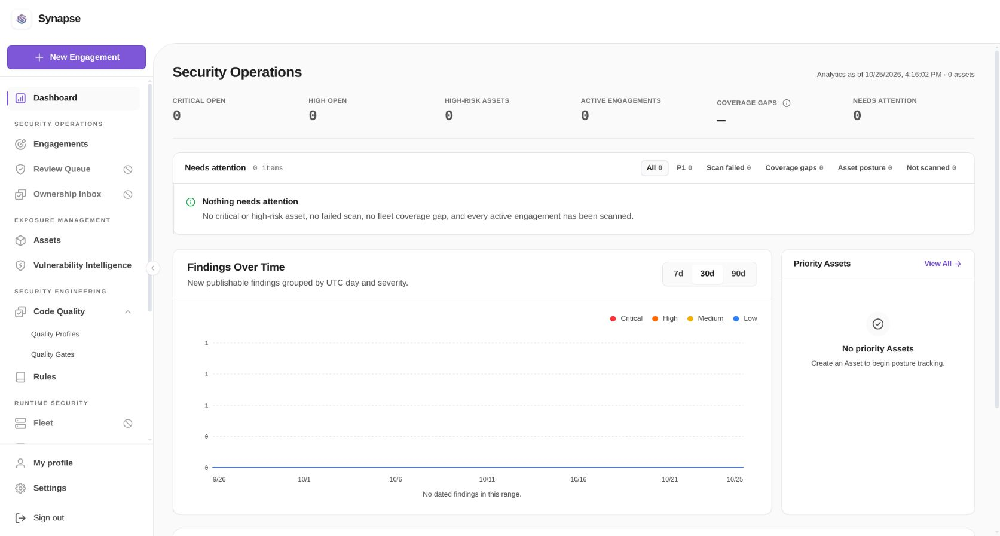

## Provider outage and reauthentication recovery

At 15:39 UTC, a timer was registered to start the exact retained Keycloak container after eight
minutes if the operator stopped. Only that existing synthetic provider container was then stopped.
The API, web, gateway, public tunnel, hostname, provider credentials, connections and Required
policy were unchanged. This run used the current shared `a2de17b9` API/web images identified at
the top of this file.

The existing Keycloak readonly user reloaded Dashboard successfully while the provider was down.
Profile reauthentication used cached discovery and reached the real public authorization endpoint,
which displayed Cloudflare's external 504 error at 15:40:36 UTC. Browser Back returned to Profile,
and a fresh source reload still succeeded. Five persons, seven memberships, eight authenticators,
connection revisions and policies stayed equal. Active upstream proof tuples remained unchanged;
no fresh provider authentication appeared during the failure.

The total session row count grew from 258 to 260 because local browser-cookie refresh rotates
session records. Those rows retained the previous 14:24:40 UTC authentication time; they do not
represent successful federation. The active source proof remained valid throughout.

Starting the same Keycloak container restored discovery at the exact existing public issuer.
Retrying the Profile reauthentication button displayed the real provider password form; using the
retained synthetic account returned through the callback to the same secondary readonly person.
Its new validated authentication time was 15:42:51 UTC. The API, web, gateway and tunnel had the
same container IDs, image IDs and start times as before. The restore timer was stopped only after
these checks and is inactive.

This proves existing-session reauthentication failure/preservation/recovery. The error was an
external provider 504, not an in-app callback error or a native 503. Browser Back supplied the
reachable retry. Signed-out Connect, allowed legacy credentials and complete canary/break-glass
rollback remain separate acceptance paths. No grant, credential or billing change was made.

Source: [`keycloak-provider-outage.json`](keycloak-provider-outage.json), with reduced proof tuples,
raw-observation hashes and fixed runtime identity. Raw authorization query strings and tokens are
not retained.

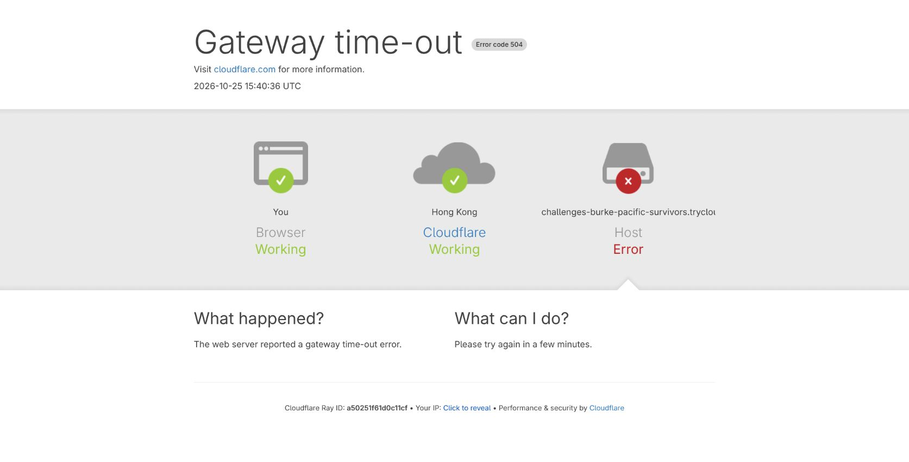

## Signed-out Connect during provider outage

A separate run signed the same readonly user out locally, verified that person had no active
Synapse session, and selected the activated Keycloak connection on the Required secondary
organization's Connect page. An eight-minute restore timer was registered before stopping only
the existing Keycloak container.

Continuing with Keycloak reached the real authorization endpoint, which displayed external
Cloudflare 502 at 15:49:47 UTC. No session was created for that person; authority stayed at five
persons, seven memberships and eight authenticators, with identical roles, policies and connection
revisions. Browser Back returned to Connect with Keycloak still selected and Continue enabled.

Starting the same Keycloak container restored exact-issuer discovery. Continue then followed the
ordinary provider SSO/callback to the same person's secondary readonly Dashboard. Recent upstream
SSO was reused, with authentication time 15:42:51 UTC; no forced password prompt or new upstream
authentication time is claimed for this ordinary-login retry. The prior separate reauthentication
run provides that fresh-password observation.

API/web/gateway/tunnel identities, images and start times were unchanged; only the same Keycloak
container restarted. The provider is restored and the timer is inactive. No invitation, grant,
credential, policy, public hostname or billing change was made. This extends the existing-session
outage proof to signed-out Connect; token-exchange callback errors, allowed legacy credentials and
complete canary recovery remain separate paths.

Source: [`keycloak-connect-outage.json`](keycloak-connect-outage.json), with reduced observations,
fixed runtime identity and hashes. The shared runtime dependency on #1612 remains explicit.

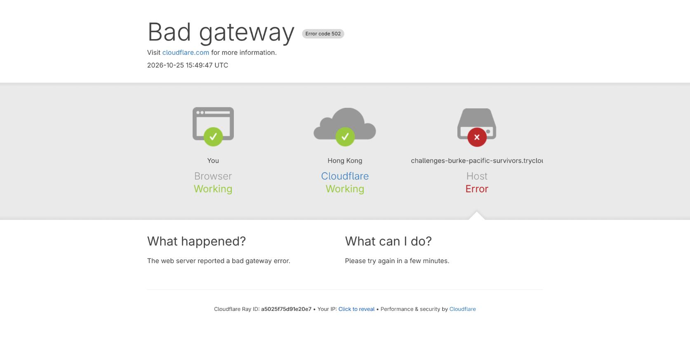

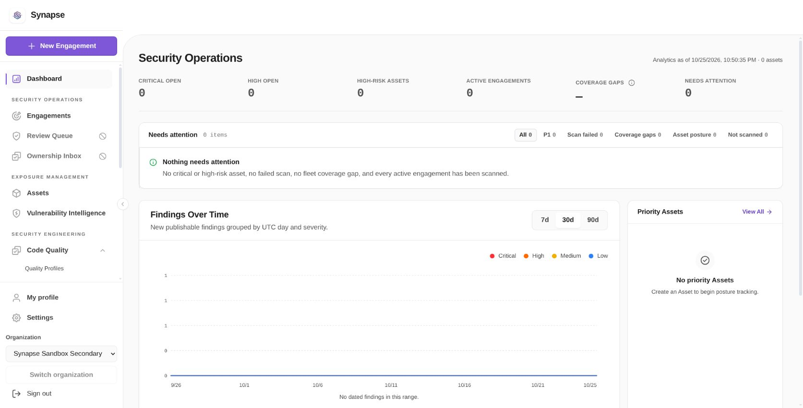

## Mailbox proof and existing-person enrollment

On 2026-10-25, the default Keycloak draft completed a real provider Test, remained absent from
Connect until activation, then was activated with explicit operator approval. Three readonly
invitations were created for the two retained synthetic users: two accepted, one diagnostic revoked.
Ordinary login before approval and use of the revoked code were denied without JIT access.

The first existing person initiated enrollment while signed in through its linked Auth0 identity.
With the Keycloak user’s boolean email verification flag temporarily false, the actual signed callback
required a subject-bound Mailpit challenge. Stopping the isolated sender prevented admission while
the initiating session remained usable. Restoring that same sender and retrying delivered a real
private SMTP message. Wrong-code submission was denied. Correct-code admission initially exposed
a `user_contacts_pkey` collision; the transaction rolled back completely.

The additive repair derives a prospective manual contact ID from the tenant and locked invitation,
retaining the value-based upsert and existing contact IDs. On the exact candidate build, a new real
callback/message/code admitted the same person, membership and readonly role. Every field of the
old manual contact was preserved and the new proven address was added. Real PostgreSQL regressions
reproduced the old failure, then passed historical-ID reuse, post-write audit-failure rollback/retry,
concurrent first admissions and exact retry. Focused tests took 3.252s; race tests took 17.663s.

For the second existing person, the retained provider flag was the JSON boolean true. Its actual
callback accepted the explicit default readonly invitation directly: zero mailbox challenges and one
verified imported OIDC contact. The controlled flags and actual verified-callback branches establish
the two outcomes; raw JWTs were not retained or directly inspected. Both users completed local logout
and ordinary default Keycloak login afterward; recent provider SSO was reused.

The second person then selected the Required secondary organization. The UI required an explicit
destination provider choice before redirect. Selecting its approved Keycloak connection completed
the real callback and reached the same person with the existing secondary readonly role. Validated
upstream authentication time was 17:33:31 UTC; no new authority was created by the switch.

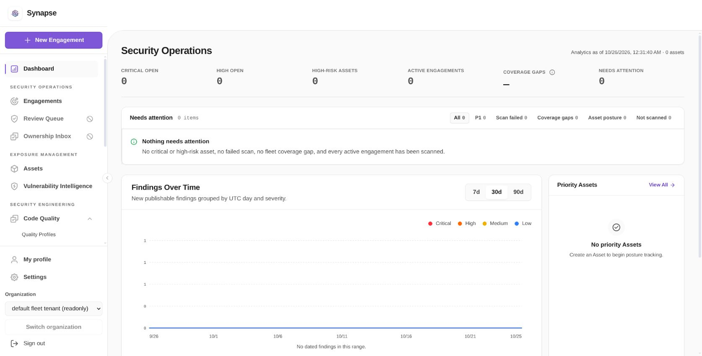

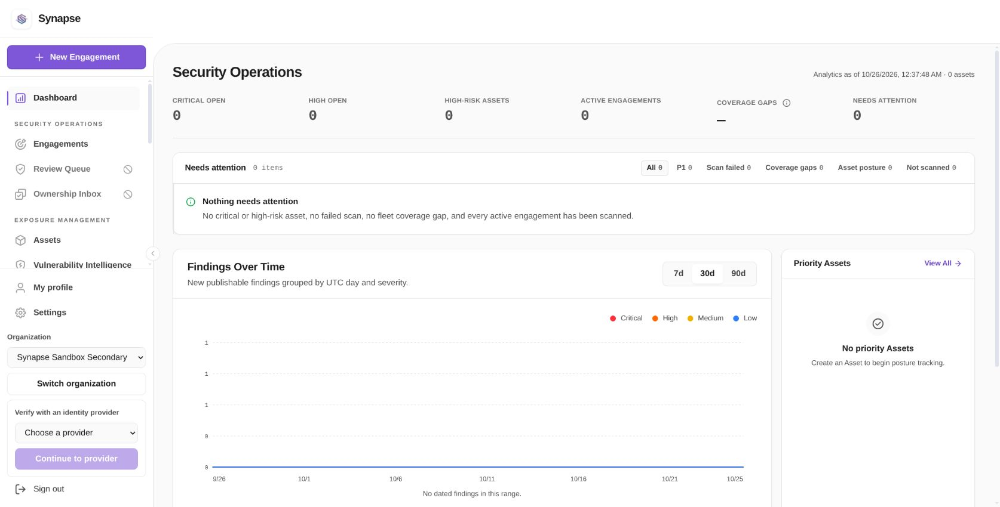

[The nonsecret proof](keycloak-mailbox-enrollment.json) binds the exact eight source hashes, candidate
images, contact/approval observations and captures. Across the two approved enrollments, counts
changed only from 5 persons / 7 memberships / 8 authenticators to 5 / 8 / 10: no new person, one approved readonly
membership and two authenticators. All provider flags and the sender were restored; the guarded
candidate preview returned to the exact reviewed baseline. Ordinary future login needs no invitation.

This records a candidate functional subset. The eight shared source files remain uncommitted at
base #1612 `043e9d74`, and are not claimed as standalone #1609 source or durably promoted code. Bounded
combined implementation QA passed; final PR review remains deferred until the complete issue
acceptance. Pairwise linking, public custom-base-path/realm proof, client-secret rotation and full
canary/recovery remain open. No billing or Auth0 signing-key rotation was performed.

## Required canary disable and recovery

The retained PostgreSQL runtime exercised this canary on 25 October 2026 at
18:20–18:32 UTC. Secondary organization SSO stayed Required at policy version 5
throughout. Disabling its existing Keycloak connection changed version/epoch from
4/2 to 5/3. Signed-out Connect then offered only the independent approved Auth0
connection; the disabled Keycloak connection and the other disabled draft were absent.

Ordinary Keycloak login to the default organization still reached readonly access,
with validated provider authentication time 18:23:34 UTC. The existing secondary
Auth0 administrator then signed in at 18:26:15 UTC and opened the protected
administration controls. No recovery credential or weaker SSO policy was needed.
A real provider Test passed before the same Keycloak connection was reactivated
at version/epoch 6/3. Ordinary Keycloak authorization subsequently returned the
existing person to secondary readonly Dashboard, reusing the recent provider session.
Five persons, eight memberships, ten authenticators, every membership role, other
connections and all organization policies remained unchanged at every observation.

A browser network-change error during the recovery Test was followed by a successful
refresh and real callback. The separate temporary custom-path gateway guard restored
the exact original gateway configuration during that interval. The Keycloak service,
root issuer, client credentials and retained links were preserved. The custom-path
realm remains disabled pending its separate additive-link authorization.

This is a real retained-browser canary against the shared runtime identified above.
It does not establish standalone PR source equivalence. Database rows reported as
unrevoked and unexpired alone are not proof that their session credentials remain
valid after an epoch change; no old browser cookie was exported or injected here.
The separate native Keycloak/PostgreSQL conformance run verifies actual rejection
of a previously valid credential after disabling its connection.
See [the nonsecret recovery observations and artifact hashes](keycloak-required-recovery.json).

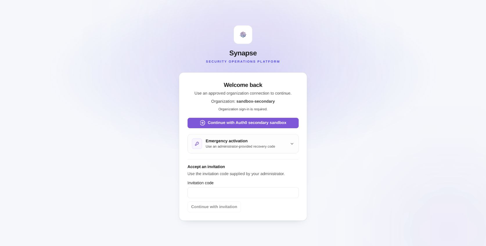

