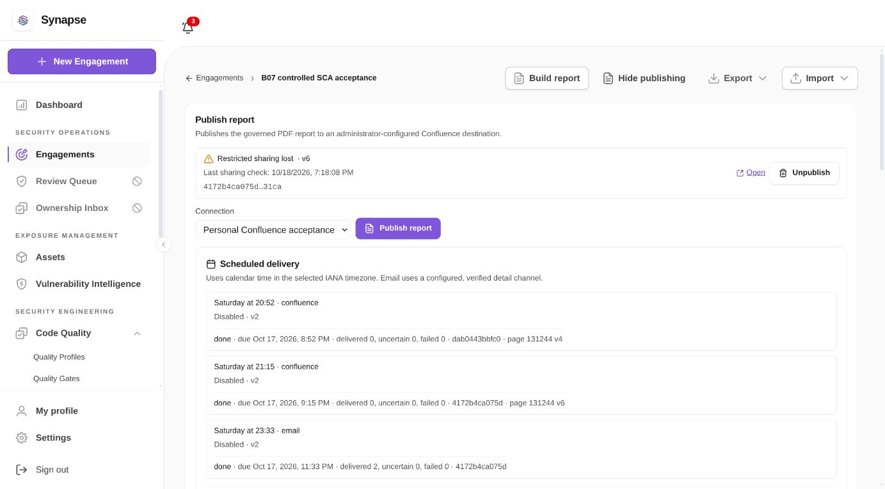

# Jira sync and report publishing acceptance

This is the current ledger for PR #1586 after review of `a5bf0239`. The
[17 October snapshot](acceptance-2026-10-17.md) and earlier check/review JSON retain
their historical scope. One PR remains owned by `pho-veteran`; it is not merged.
B04/#1434 and #1442/PR #1577 remain reused.

## Current acceptance disposition

All eight issues use `Refs` until their complete acceptance is established. Current
Cloud observations below are real API/worker/provider operations. Historical
captures, automated contract tests and unavailable reruns are distinguished;
mocks do not substitute for provider acceptance.

| Order | Issue | Current correction and verification | Current live scope and remaining acceptance | Disposition |
| --- | --- | --- | --- | --- |
| 1 | #1431 | Per-ticket status 400/404 no longer stops unrelated creates/status writes; credential and create-mapping fences remain. | Cloud connection succeeds after credential refresh. No new complete auto-push producer/DC run; old captures remain historical. | Refs |
| 2 | #1432 | Group/canonical-asset contracts remain covered. | No new multi-asset Cloud/DC producer run. The prior private source under `/tmp` was lost on restart. | Refs |
| 3 | #1433 | Transition/comment/update idempotency and explicit refused-field retry regressions include quiet repeated ticks. | No current complete native Cloud/DC lifecycle rerun. | Refs |
| 4 | #1435 | Signed/replay/tenant Router harness and proposal-only reducer contracts remain covered. | No current Cloud-origin or licensed DC native callback rerun; historical callback proof remains scoped to its run. | Refs |
| 5 | #1436 | PostgreSQL/memory regressions pin monotonic deletion, bounded historical catch-up and reconciliation. | Current worker can read Cloud again; no controlled provider polling/drift acceptance rerun is claimed. | Refs |
| 6 | #1443 | Exact restrictions precede upload. Known vendor control/audit fields are typed; unknown, conditioned and duplicate policy keys fail closed. | Fresh Cloud page `98630`: create and update each Done in one attempt; unchanged content skipped; three real PDFs downloaded/rendered; purge independently returns HTTP 404 for current/trash/history/all attachments. DC rerun remains unavailable. | Refs |
| 7 | #1444 | Authority, legal hold, tenant/CAS and retirement guards remain covered. Read-only periodic checks persist/audit sharing loss or unverifiability. | Real console warnings observed on retained page `131244` whose group differs from current configuration. New page `98630` was verified by the monitor and then released/purged through normal API. Current DC/complete permission-provider matrix remains missing. | Refs |
| 8 | #1445 | Schedule/time-zone, recipient authority, frozen artifact and no-resend contracts remain covered. | Real weekly Cloud occurrence at 19:30 Asia/Ho_Chi_Minh on 18 October 2026 produced page version 4; schedule then disabled. No fresh Gmail/Outlook send/open run. Historical Gmail receipt and Outlook preview failure remain explicit. | Refs |

## Current Cloud evidence

[Fresh Cloud proof](review-cloud-provider-proof.json) records the final source
fingerprint, normal Docker API/worker intents, exact sharing verification, calendar
occurrence, PDF hashes, monitor checkpoint and authenticated purge readbacks.
No manual ACL repair or prepared-page resume was used for page `98630`. The initial
empty report, update with one synthetic finding and scheduled report with two
synthetic findings are stored-source report tests, not new scanner results.

The first strict-parser run stopped at a neutral shell with zero uploads because
it rejected vendor audit metadata. That refusal was diagnosed before the successful
fresh run; the failed neutral page `65918` remains fenced. The corrected parser
explicitly types the six known controls and observed audit fields rather than
silently discarding extensions. The adapter's full live sharing proof took 5.232 s
in the recorded readback; this is one lab observation, not a latency percentile.
The monitor now claims one link with a 10 s observation / 12 s pass budget.

[Availability/monitor proof](review-provider-availability.json) retains the initial
HTTP 401/403 from expired credentials responses and records successful connections after one-day
credential refresh. Retained page `131244` still uses an earlier group, so its current
configured-group proof correctly refuses; the worker records `restriction_lost`
and an append-only warning event without changing remote content or permissions.
The new page's monitor checkpoint was `verified` before purge. Observation is
point-in-time and does not guarantee later administrator behavior.

The [current preview manifest](review-report-previews.json) covers five PDFs and
all six rendered pages, plus the [visual gallery](visual-previews.md) includes both
new console warning states. Every new PDF page was inspected. One theme suffices.
Earlier screenshots/PDFs remain design/history evidence with their original scope.

## Environment and limits

The isolated Docker API, integrations worker, web, PostgreSQL and MinIO were
restored from retained configuration/data. Lost `/tmp` files included TLS and
private producer scripts. Mailpit could not restart because its temporary TLS
certificate was lost; no email rerun is claimed. The disposable lab already had
old unmerged migration `0251` applied, so the new cursor DDL was installed separately for lab
rehydration. Fresh isolated migration tests exercise the actual migration entry
point; lab rehydration is not production migration evidence.

The retained official three-hour DC licenses expired on 17 October 2026; their app/TLS
containers remain stopped and data is preserved. The current Cloud proof does not
establish DC acceptance. No license bypass, clock change or unlicensed run is used.
All acceptance schedules are disabled. The API token and policy-read key were
refreshed for one day with existing scopes, values private/vault-only. The Gmail
OAuth client/grant remain intact until the user reports merge; cleanup automation
stays paused. Billing and school resources were not changed.

The repository contains scrubbed observations and hashes, not credentials or
independent provider access. A reviewer cannot independently re-read private labs
from these artifacts alone. That limitation and the missing reruns keep all eight
issues at `Refs`. Current checks and exact source/timestamp provenance are recorded
in [the verification summary](verification-summary.md).
