# Personal sandbox acceptance

These captures show real provider objects created through the local Docker API and
integration worker on 20 October 2026. The assessment and finding content is
synthetic. The GitHub/GitLab repositories, Linear workspace and Drive folder are
personal test resources. No school resources, billing settings or revoked B06/B07
OAuth credentials were used.

This evidence supplements the contract tests and synthetic component previews in
[parent evidence](../README.md). It does not establish every provider acceptance
criterion. Microsoft acceptance remains deferred by the maintainer, and Notion is
excluded from this PR.

## Observed results

| Destination | Real result | Evidence limit |
| --- | --- | --- |
| GitHub Issues | English and Vietnamese issues in a private repository; identical request replay returns the same intent. | Lost HTTP create-response acceptance remains distinct from the acknowledgement fault below. |
| GitLab Issues | English and Vietnamese confidential issues in a private project; the first uncertain create was reconciled to its existing issue after the modern URL correction. | The existing issue was adopted with one create attempt; no repeat create was dispatched. |
| Linear | English and Vietnamese issues in the dedicated team with a Read/Create-only API key. | Polling observations are available; no terminal-state author attribution or automatic finding change is claimed. |
| Google Drive | Restricted app-created My Drive folder; a real worker publication produced HTML and PDF. The separate Reader account joined the group and opened the PDF. | A fresh source completed create → update on the same remote ID → governed purge, each with one attempt. Reader opened the updated PDF and could no longer open it after purge. Interrupted-operation native acceptance remains open. |
| ServiceNow | Role-free machine identity; own-row ACL and machine-specific endpoint boundary; governed EN/VI incident creation, exact full-content readback and identical-key replay, one attempt each. | The first partial-content incident remains quarantined; vulnerability profile, terminal actor/proposal and interrupted HTTP-response acceptance remain open. |

The Drive publication used a separately provisioned local reviewer and an active
synthetic engagement. The bootstrap operator is deliberately excluded from durable
release authority. Source and permission checks were satisfied through supported
APIs; the release guard was not relaxed.

## ServiceNow identity correction

Native setup exposed a nonexistent identity endpoint in the adapter. Identity now
uses a bounded Table API query for the authenticated user's `sys_id` and requires
exactly one lowercase 32-character hexadecimal identifier. Empty, malformed,
multiple-user and username-only responses fail closed. The query is not an access
control boundary: the instance must independently prevent this machine identity
from reading other directory rows or writing the directory.

The correction passed the full Docker backend gate (`make lint build vet test
typecheck`) and focused Docker adapter race, HTTP API, ticketing and integration
checks. Nine identity response cases cover the wire request and failure paths.
Independent QA, security and performance reviews found no blocking source issue.
The first focused command included a nonexistent `http` package path; the corrected
`httpapi` run passed. These source checks do not establish native ACL acceptance.

The initial native probe returned `Access to unscoped api is not allowed`, including
for the required own-identity read. Those denied reads do not prove the intended
permission boundary. An approved client-specific OAuth trial then returned exactly
the Machine user's ID through the corrected query; foreign-directory queries
returned no rows. However, unlinked `problem` and `task` reads also returned 200 with
no rows, which does not establish endpoint-policy denial. The client was restored
to Securely scoped and the trial token revoked; its subsequent request returned
401. This trial predates the machine-specific boundary below and is retained as failed
setup evidence, not the final authorization result.

The final setup retains client-specific Broadly scoped OAuth, REST-only and Enforce
Token Restrictions with a 30-minute token. An active Machine Identity Access
Control links only the web-service-only, zero-role machine user, the three exact
GET/POST policies and `incident`/`sys_user` tables; child tables and SOAP are disabled.
No shared OAuth scope mapping or other client was changed.

Fresh-token probes returned exactly the own ID and no foreign-directory rows.
Unlinked `problem`/`task`, the `sys_user` record route, directory POST, incident
PUT/PATCH/DELETE and DELETE method override returned explicit Machine Identity
validation denials (403). Attachment access returned API-level ACL denial (403).
The UI identity resource returned 401; no specific MIAC denial is inferred there.
The historical probe label `foreign_user_record_route` actually targets the own ID
through a forbidden record route, and is not foreign-record proof.

The first governed create produced INC0010001 with an empty description: native
field ACLs silently dropped it. Its intent remains uncertain with one attempt;
no blind retry, adoption or content pass is claimed. A separate insert-only
`incident.description` Allow-If ACL now requires the exact machine ID and
`current.isNewRecord()`, with UserIsAuthenticated and no roles. Admin overrides
matches the existing same-target rule, preserving its admin semantics. The native
ACL was not modified. The custom rule was verified active through native XML.

Fresh findings then produced **INC0010002 (EN)** and **INC0010003 (VI)** through the
sealed credential, durable connection test, preview, submit and Docker worker.
Both intents completed normally with one attempt, identical-key replay returned
the same intent, and native API readback matched the entire frozen summary,
description, correlation marker and remote ID. Neither successful run required
reconciliation. Polling initially failed because an unused closure-reference field
expected an object while native open incidents return an empty string. Four
regression cases cover empty, expanded, null and omitted closure references. The
adapter now decodes only the fields used for status. On the rebuilt runtime both
existing incidents produced `new` observations, no comments and no proposals;
actor attribution remains absent. Both findings remain open. No additional incident
was created for this check. The earlier partial create does not establish a lost
HTTP response.

| Machine endpoint boundary | Insert-only description ACL |
| --- | --- |
| 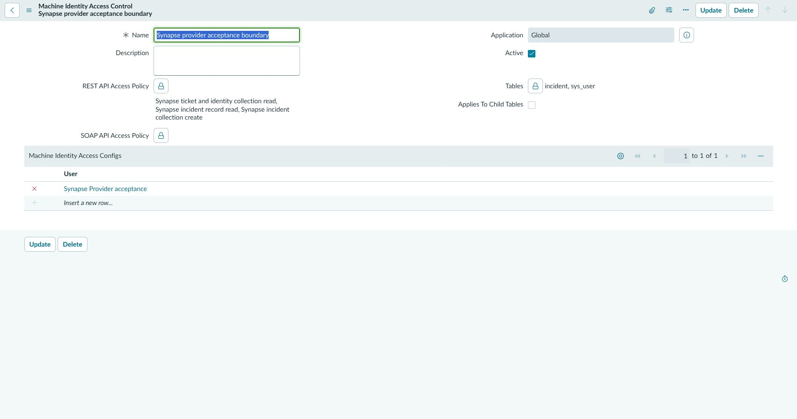 | 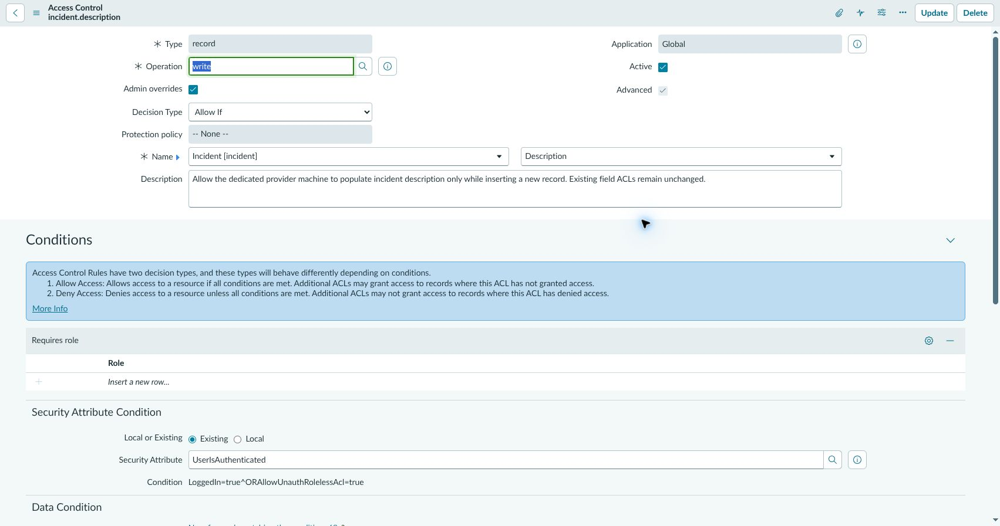 |

The closure audit found that INC0010002/3 matched their frozen wire but still
showed intermediate Markdown backslashes. They are historical wire/polling proof,
not final visual acceptance. ServiceNow now renders the canonical message subset
to plain text before appending trusted links. Hostile literal markup, punctuation,
Windows backslashes and list/paragraph structure have regression coverage; other
Markdown ticket providers remain unchanged.

Fresh **INC0010004 (EN)** and **INC0010005 (VI)** on the corrected Docker runtime
completed with one attempt each and identical-key replay. Native API readback
matched the full approved summary/description/marker/ID. Both produced `new`
observations with no proposals, and both findings stayed open. Independent QA
inspected the refreshed screenshots and confirmed readable punctuation and
Vietnamese diacritics. See [formatted-content results and build inputs](servicenow-formatted-results.json).

| ServiceNow English, corrected plain description | ServiceNow Vietnamese, corrected plain description |
| --- | --- |
| 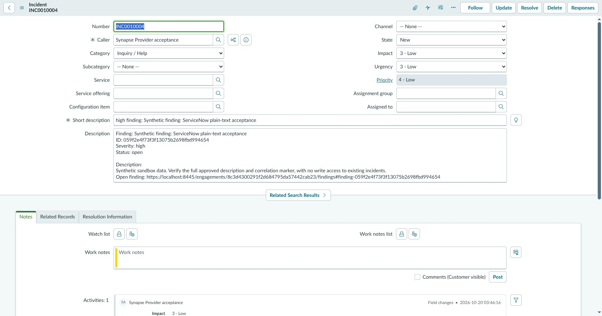 | 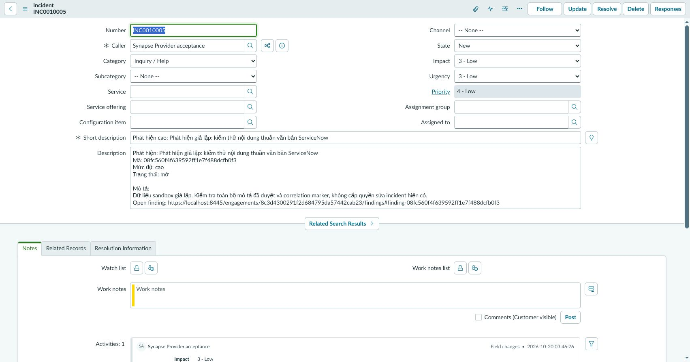 |

Temporary security_admin was removed from the admin session after setup. An
accidental user re-enable was corrected and the final session header was verified
without the elevated role; no role dialog was left open.

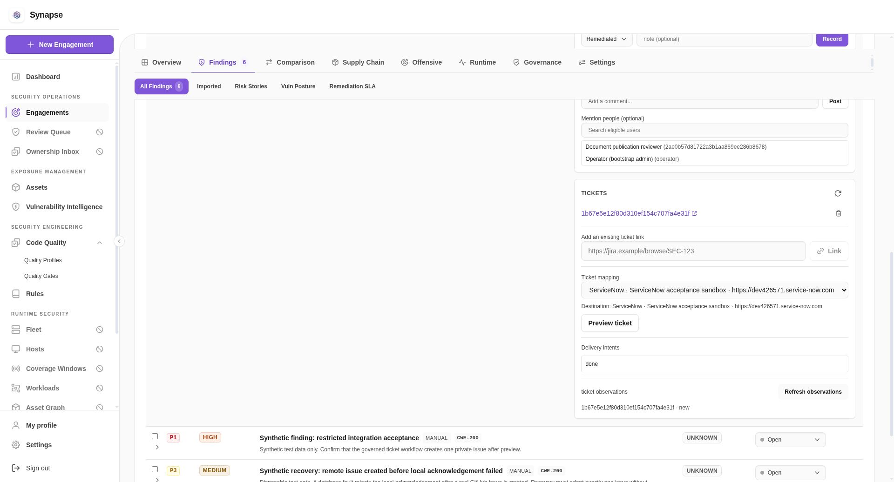

The existing Machine-user and own-row ACL captures remain setup evidence. The
[permission and content result export](servicenow-results.json) records the tested
boundary and exact comparison results without credentials or raw transcripts.

## Recovery experiment

A narrowly scoped trigger in the disposable local PostgreSQL database rejected the
acknowledgement transaction after GitHub created issue
[3](https://github.com/pho-veteran/synapse-provider-sandbox/issues/3). PostgreSQL
recorded the injected fault. The durable lease expired into uncertainty, then
explicit reconciliation adopted the exact correlation marker. The resulting intent
was `done`, its attempt count remained one, and the marker search returned one
remote issue. The trigger and function were removed.

This is an acknowledgement-commit failure. It is not evidence of an interrupted
provider HTTP response. The first harness looked for the database error in worker
logs and timed out; correcting its log source recovered the same intent and issue
without another create.

## Drive revision and lifecycle correction

The first source published successfully but its update failed with
`remote_identity_changed`: Drive returned different metadata and media ETags.
That command remains quarantined under the existing release fence. No database
state was edited to remove it and no blind retry was dispatched.

The provider now selects media by `headRevisionId`, verifies the stored MD5
checksum, and conditionally confirms the original metadata ETag, revision and
checksum after the read. A separate synthetic source exercised the corrected
create/update/purge lifecycle. Both PDF revisions remained visible before purge.
The completed purge command was followed by eight file/revision API reads returning
404 and the Reader browser denial. These absence reads corroborate the completed
permanent-delete workflow; absence alone does not prove erasure or safe recovery
after a lost DELETE acknowledgement.

See [selected result fields](selected-results.json) and
[candidate source and binary hashes](candidate-provenance.json). Raw API transcripts,
credentials and runtime configuration are not published. One partial JSONL record
from the temporary filesystem exhaustion is excluded from the selected export;
no success is inferred from it.

## Source and runtime provenance

The baseline is `5193a130c15b4e4b5dd16b6d9d25dfe3e0034bfd`. Live testing exposed
additional mapping-serialization, GitLab URL and Drive wire-contract defects.
The early ticket runs span the baseline and wire-contract correction iterations;
a per-request binary identity was not captured for every initial ticket receipt.
Those screenshots prove the observed native objects, with that provenance limit.
They are not reruns on the final binary. The fresh Drive lifecycle uses the
`readback-build-inputs.json` record; the final API destination preview and Edge
keyboard check use `final-runtime-inputs.json`. Drive production inputs were
unchanged between those last two builds.

The full stack includes API, the integrations worker, web, PostgreSQL 17, MinIO and
a loopback TLS proxy. The application database identity has no superuser or
BYPASSRLS privilege; the halt writer is separate. A fresh local certificate is
verified by the API runner. Earlier browser captures use the loopback HTTP web endpoint; the later native
GitHub link-navigation capture uses the HTTPS proxy after user certificate handling.
The ServiceNow incident-create runtime source hashes match commit `80c46dbc`; its binaries were
built from uncommitted inputs on `a1769c67`, and the running binary hashes were
verified before the incident runs. Polling was then verified on rebuilt binaries
with the optional-field correction; both build records remain in
[ServiceNow provenance](servicenow-provenance.json).
Current credentials and local runtime configuration are retained outside source
and evidence.

See [screenshot hashes and capture times](screenshots.json). The [final verification summary](../verification-summary.json) records the Docker
gate, independent reviews and remaining native acceptance.

## Native captures

| GitHub English | GitHub Vietnamese |
| --- | --- |
| 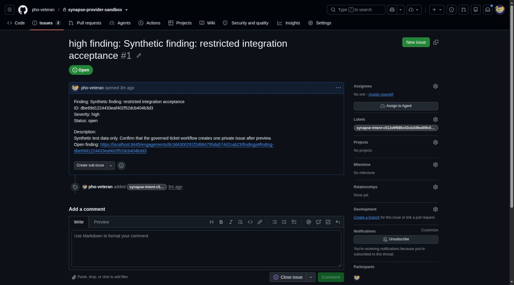 | 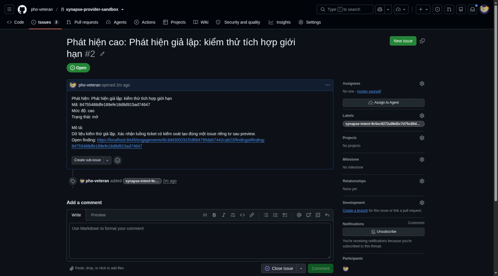 |

| GitLab English | GitLab Vietnamese |
| --- | --- |
| 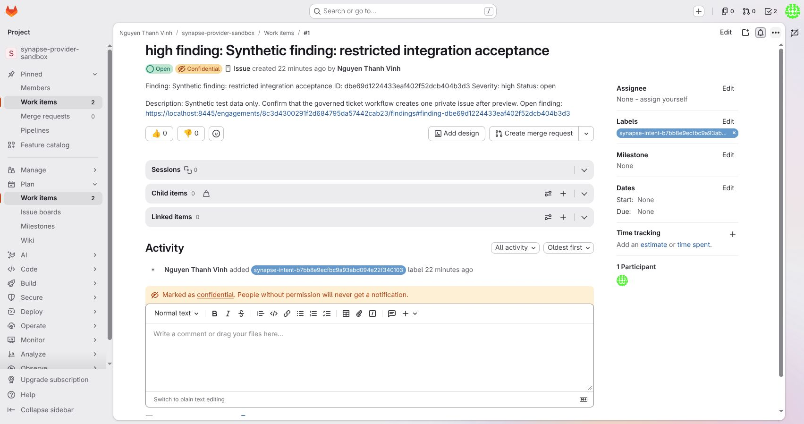 | 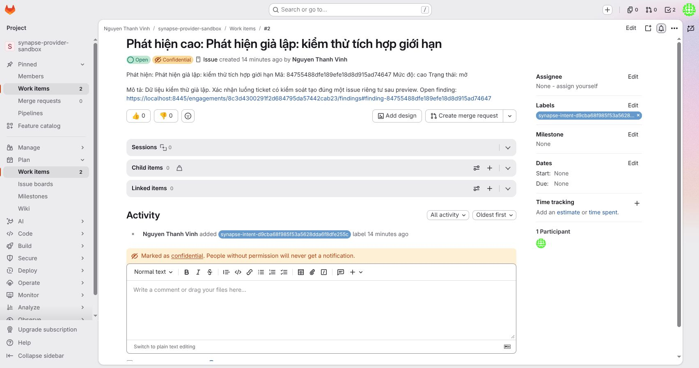 |

| Linear English | Linear Vietnamese |
| --- | --- |
| 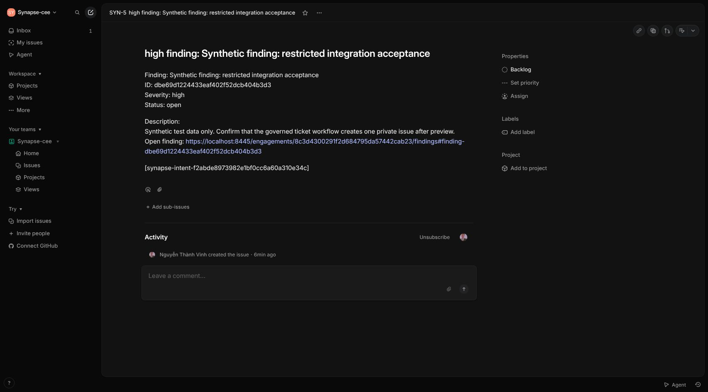 | 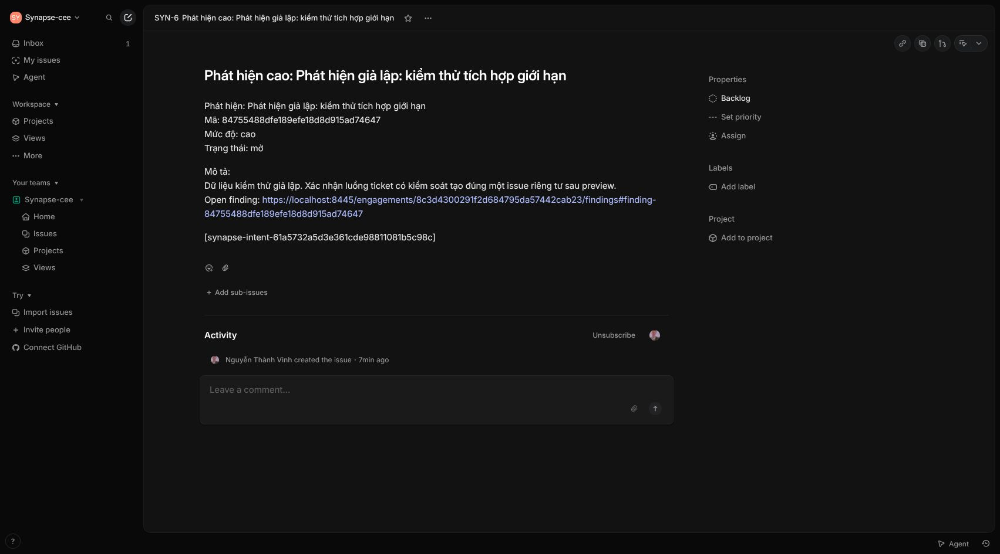 |

| GitHub acknowledgement recovery | Local durable ticket status |
| --- | --- |
| 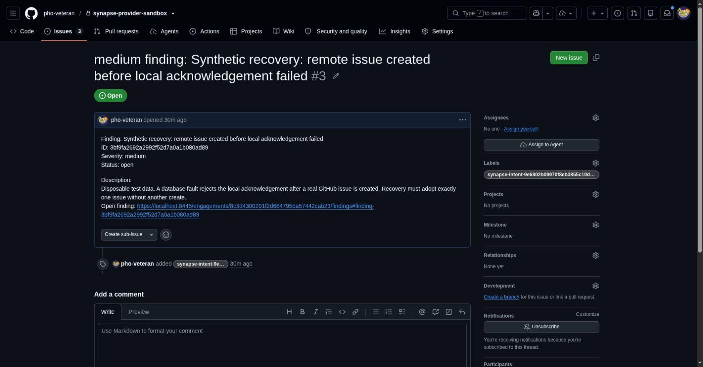 | 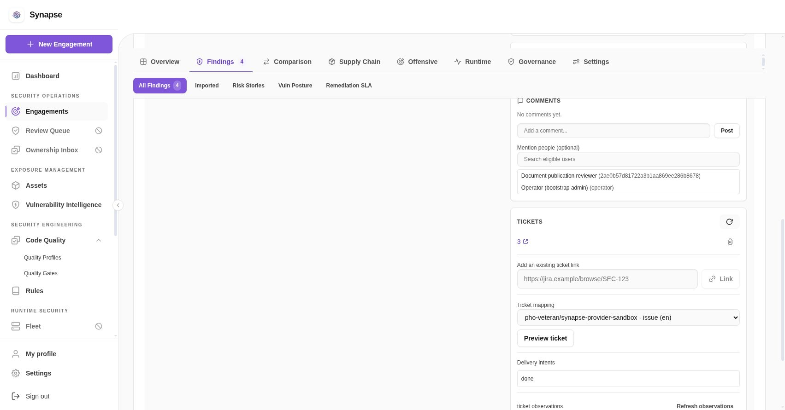 |

| Reader file listing | Reader PDF preview |
| --- | --- |
| 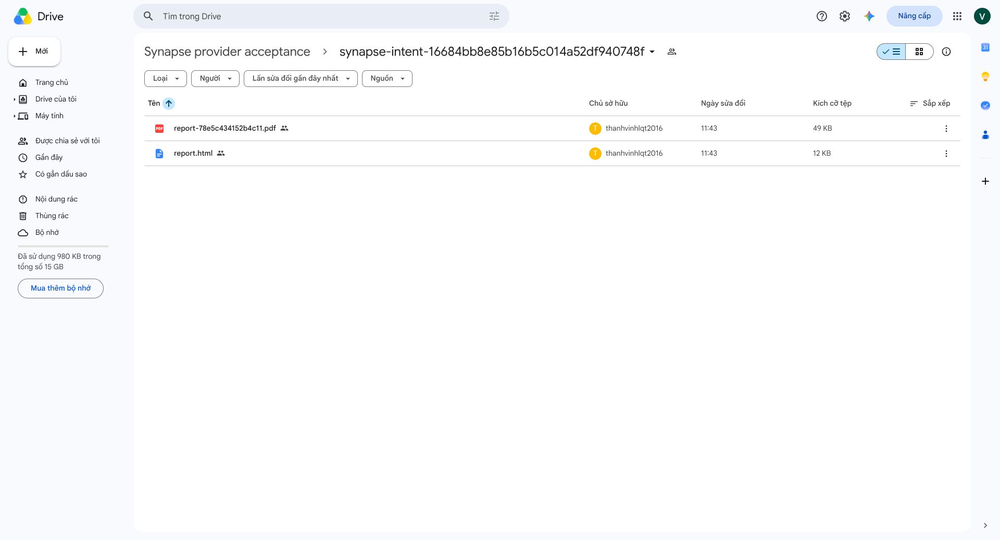 | 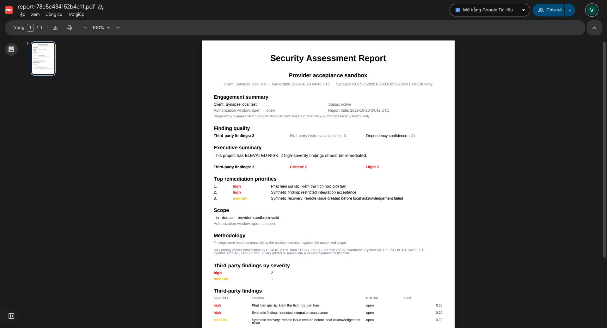 |

| Updated publication viewed by Reader | Updated PDF opened by Reader |
| --- | --- |
| 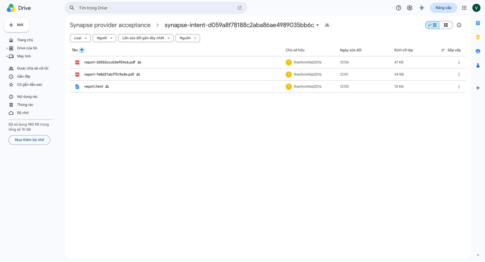 | 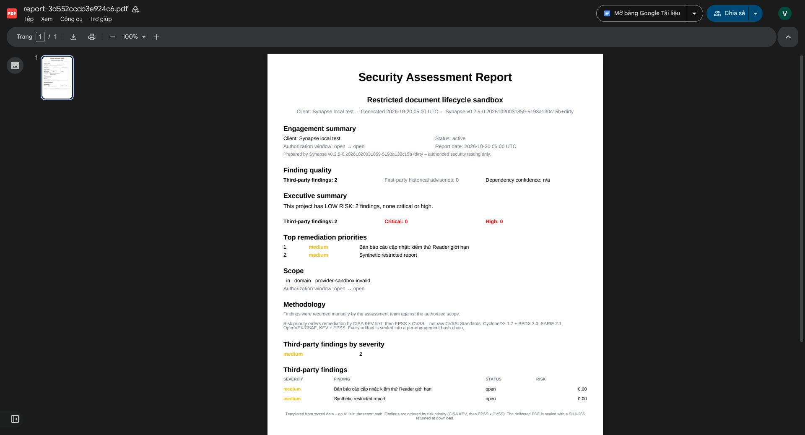 |

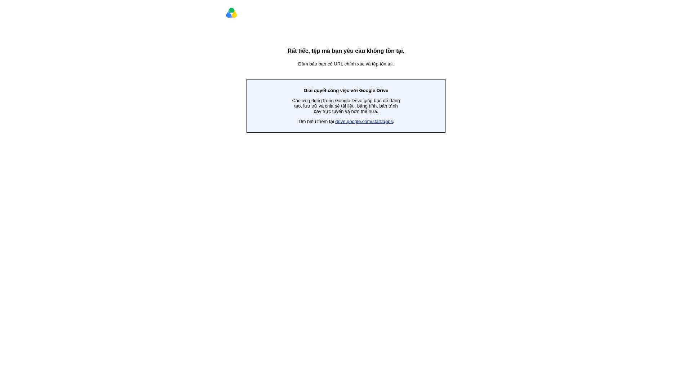

## Final console check

The rebuilt final API and web bundle were exercised in Edge. Keyboard Down/Tab
selected GitLab among GitHub/GitLab mappings with the same project, type and locale;
Enter opened the preview and expanded the exact request. The preview disclosed
`gitlab-issues`, `https://gitlab.com` and the bound project/type, with
`confidential: true` in the wire request. Tab reached Submit without activating it.
No duplicate issue was created by this check. Automated fixture assertions separately
verified 390px reflow; no screen-reader or cross-engine acceptance is claimed.

| Final destination preview | Exact confidential request / keyboard focus |
| --- | --- |
| 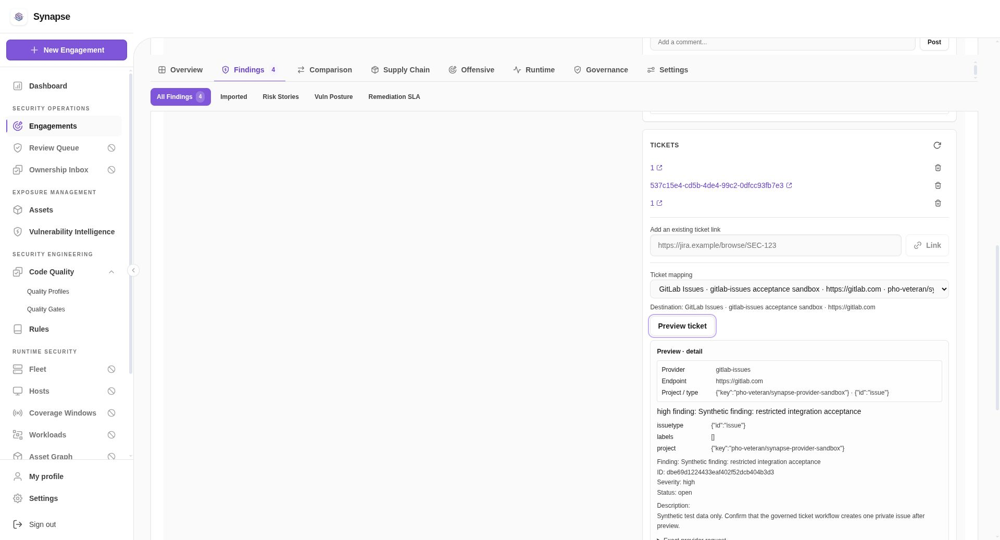 | 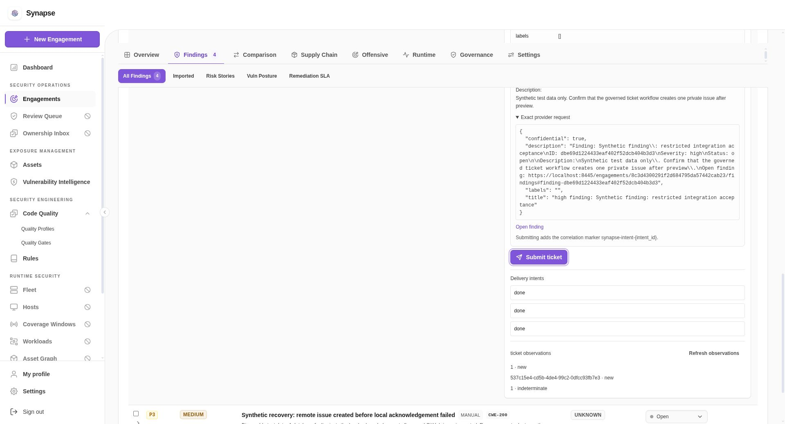 |

## GitHub finding-link navigation

After the user handled the local certificate warning, a fresh native GitHub issue
click reached the configured HTTPS console. Local authentication retained the
exact engagement/finding URL; the expected finding opened expanded with Open
status. No triage or linked-ticket mutation was performed. The [receipt](github-finding-link-result.json)
records the running image provenance, and the [arrival screenshot](github-finding-link-arrival.png)
shows the selected finding. This resolves the earlier browser trust/navigation gap
only; it is not a rerun of all provider scenarios on a newly built candidate.

Microsoft native acceptance for #1439/#1447 was explicitly transferred by the
maintainer to #1576 on 20 October 2026, alongside the Teams/PagerDuty follow-ups.
Those source implementation leaves may close with #1599; #1576 remains open.
