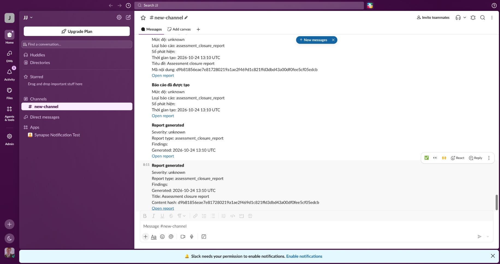
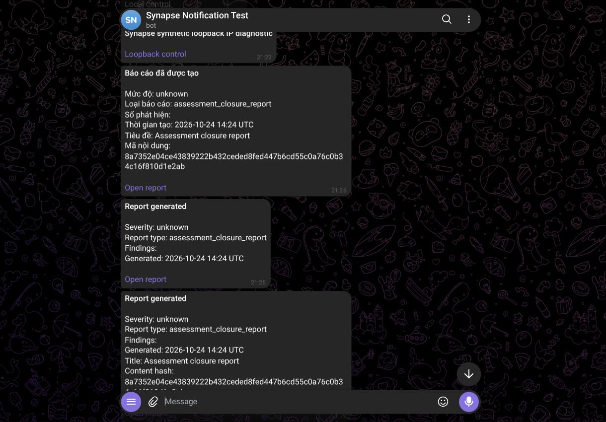
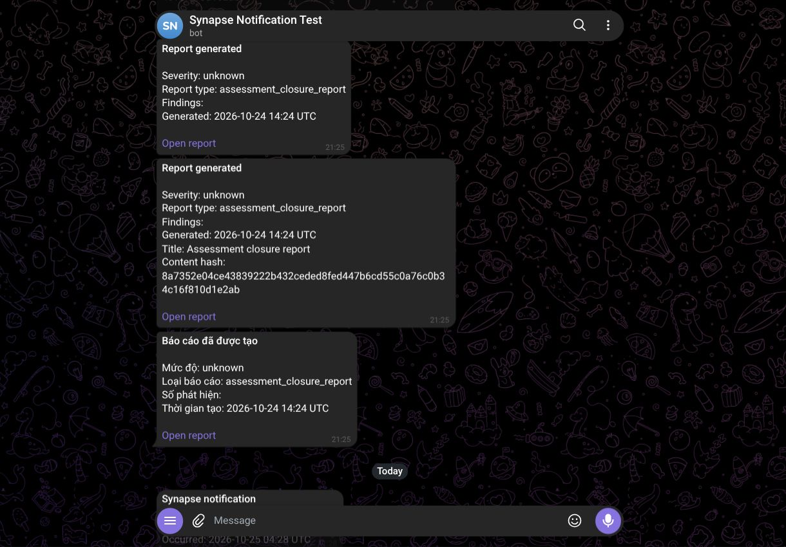
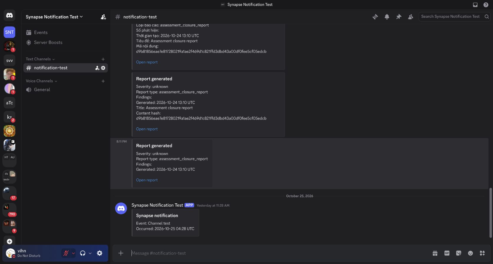
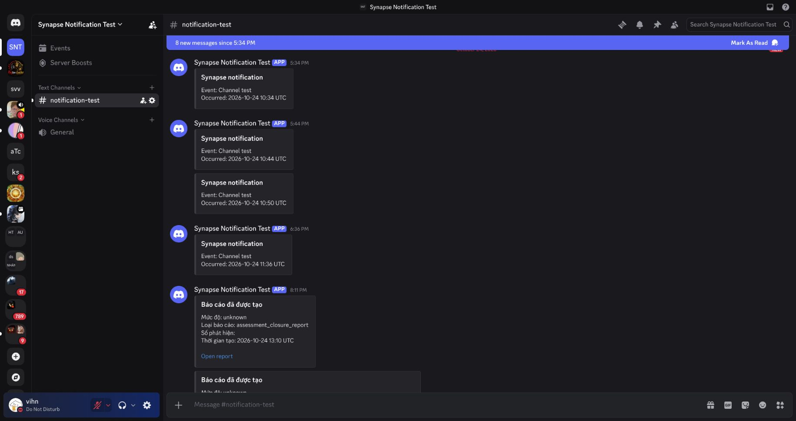
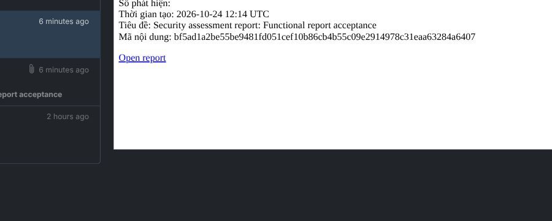

# Native report delivery acceptance

The sandbox run used immutable source uploads, real SCA pipelines, a retest and a native lifecycle comparison. Closure admission refused incomplete coverage before an explicit waiver limited to this dependency-free synthetic fixture. The run makes no claim of exhaustive assessment coverage.

The worker completed report generation before the first report GET. One sealed artifact produced one durable source and one event. Slack, Discord and Telegram received twelve messages across English/Vietnamese and signal/detail. Cached GETs, retained-command replay and a coordinated runtime restart kept the bytes and source/event/delivery counts stable. A later run on the final candidate delivered four signed webhook requests; receiver-parsed bodies verified HMAC and signal/detail filtering.

| Evidence | What it establishes |
| --- | --- |
| `report-delivery-functional.json` | Native closure producer, twelve real chat delivery outcomes, cache/replay/restart and browser observations |
| `report-delivery-webhook-final.json` | Final-candidate worker-first production, one native source/event and four successful webhook deliveries |
| `report-webhook-final-received.json` | Receiver-parsed bodies, event/delivery identity, signature and class-filter checks |

The Slack report link opened the correct cycle and immutable closure history with a readonly session. The initial Telegram run rendered the localhost link label as plain text. A bounded Bot API control showed that Telegram omitted the localhost text-link entity while keeping a public HTTPS link, then kept a loopback-IP HTTPS link. The sandbox now uses the existing trusted `https://127.0.0.1:8445` listener for outbound links. A later native closure run delivered four EN/VI signal/detail messages with clickable Telegram anchors. Clicking one reached the correct cycle and Closure v7 after normal development-token sign-in with the existing synthetic reviewer. Unauthenticated access first showed the sign-in page. No OIDC certification is inferred from that token login. Repeated theme testing was waived by the operator. No theme matrix is claimed.

`report-delivery-telegram-loopback.json` records the native worker-first delivery, retained-command replay, four browser anchors and correct landing. The Auth0 legacy callback remains on localhost; no public listener or tunnel was added for this change.

The engagement and Project quality producers also ran through the native document scheduler. The engagement used the stored assessment above. The Project used a separate immutable ZIP uploaded through the Project API and a completed native analysis with a persisted source-manifest digest. Each scheduled occurrence froze a PDF, captured one report source/event, delivered the PDF and four EN/VI signal/detail notifications to a private SMTP sink. The five received MIME messages per producer were read from persistent Mailpit storage; the attachment matched the frozen PDF byte for byte. Notification HTML anchors and class filtering passed. Clicking the received email links opened the correct Engagement and Project overview; the Project route used its key rather than its database ID.

`report-engagement-smtp.json` and `report-project-quality-smtp.json` record those runs without recipient headers. After a coordinated restart, each retained one occurrence, one source/event and four notification deliveries, with unchanged PDF bytes and no extra SMTP messages. The schedules and routing rule were disabled after the controlled runs; configuration, encrypted reviewer credential and receipts remain in the local sandbox.

`report-projection-recovery.json` covers an actual process crash after commit and before projection. Both projector profiles (`notifications` and `integrations`) were stopped. The native worker finished, and SQL confirmed the stored report bytes/hash, one unprocessed durable source and zero projected events. API and lifecycle processes then received SIGKILL. After restoring the pinned runtime, the source projected into one event with four actual EN/VI signal/detail SMTP receipts. Stored report bytes/hash and cached reads stayed stable, with no extra SMTP messages. The first preflight stopped only the notifications profile and was rejected because integrations also projects sources; that attempt is excluded from crash evidence.

## Limits and rollout

This record covers native closure production and scheduled engagement/Project quality PDF production. Direct remote publication through document commands is not established by the schedule runs. The accepted release scope covers configured Slack, Discord, Telegram, SMTP email and webhook delivery. Actual SMTP/Mailpit receipt establishes the email-family function, MIME/PDF integrity, rendered HTML and correct links. Gmail has no configured SMTP/OAuth channel in this sandbox; Gmail and Outlook web-client rendering are unverified and outside this live-channel scope. Excluded providers remain excluded. This follows the operator's 26 October decision to accept established functional proof without adding provider setup or repeated theme/client sweeps. The producer, isolation, template/context goldens and crash-recovery gates remain required and passed; this scope decision does not weaken them.

Replace API, lifecycle, integration and notification writers together. Mixed versions retain the original capture defect. Broken baseline artifacts were preserved for diagnosis; cached reads do not backfill their missing events. Historical reconciliation requires a separate decision. Queue retry is safe for artifact/source atomicity, while an external provider accepting a request before acknowledgment is lost can still cause at-least-once delivery. No process-kill-between-commit-and-ACK experiment or throughput improvement is claimed.

No card, paid plan, paid inference or cloud server was used. The accountless webhook receiver is limited to synthetic metadata, expires after seven days and accepts at most100 requests. Its private address and signing secret are excluded from this evidence.

## Published client captures

These retained captures use the original v1 templates. The v2 chat, email and pager templates omit absent Findings and Severity lines while retaining known values, including zero; renderer regressions cover that correction. The historical messages and images remain unchanged.

The Slack frame contains the original native EN/VI signal/detail receipts. The two Telegram
frames were recaptured from the retained sandbox bot conversation and together show all four
native loopback-link receipts. Telegram capture excludes the unrelated chat sidebar; the rendered
messages were not edited. Hashes and the exact report identities are in `receipts/manifest.json`.

The following Discord frames show both English classes and a Vietnamese signal example; the original Vietnamese frame only includes the beginning of its detail message. The native receipt records cover all four deliveries. The SMTP frame is a retained excerpt of the actual Vietnamese detail email body; the adjacent SMTP receipts establish the complete four locale/class deliveries, rendered anchors and PDF bytes. This evidence does not claim a full email-client screenshot matrix. No message content was edited.

These frames do not add Gmail evidence or a theme sweep.
